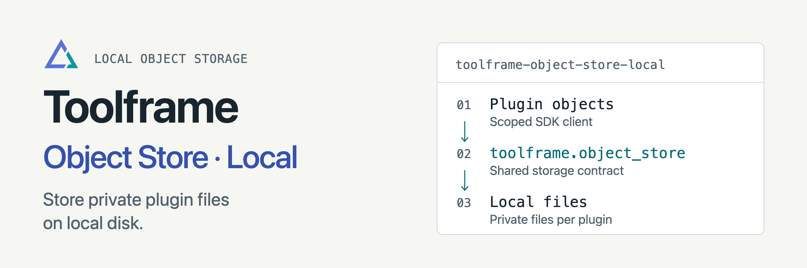

<p align="center">
<picture>
  <source media="(prefers-color-scheme: dark)" srcset="docs/assets/readme-banner-dark.png">
  <source media="(prefers-color-scheme: light)" srcset="docs/assets/readme-banner-light.png">
  
</picture>
</p>

# Toolframe Local Object Storage

[](https://github.com/toolframe/toolframe-object-store-local/actions/workflows/ci.yml?query=branch%3Amain)

Store private binary files on local disk through Toolframe’s scoped object client.
Business plugins can use the same client with a local or S3-compatible provider.

## Quick start

In a running [Toolframe application](https://github.com/toolframe/toolframe-core#readme):

```sh
toolframe --home APP plugin add pypi:toolframe-object-store-local==0.2.1 --enable
```

Use Python 3.14+, Core 0.7+ and SDK 0.4+. Plugins declare a dependency on
`toolframe.object_store`, then use `RuntimeContext.object_store()` to put, get,
list and delete objects. See the [client example](docs/storage.md).

**Storage:** at most 64 MiB per object; completed objects survive plugin removal.
One object-store provider is enabled per application. No public download URL is
created, and changing providers does not move data. This backend targets modest
collections on a local filesystem; network filesystems are unverified.

## Guides

| I want to… | Start here |
| --- | --- |
| Read, write or back up files | [Storage behavior](docs/storage.md) |
| Use the shared client | [SDK object storage](https://github.com/toolframe/toolframe-sdk/blob/main/docs/object-storage.md) |
| Choose an S3 backend | [S3 provider](https://github.com/toolframe/toolframe-object-store-s3) |
| Contribute or run checks | [Contributing](CONTRIBUTING.md) · [Verification](docs/development.md) |
| Publish a package | [Releasing](docs/releasing.md) |

[Releases](https://github.com/toolframe/toolframe-object-store-local/releases)

## License

[Apache 2.0](LICENSE), with [NOTICE](NOTICE).
